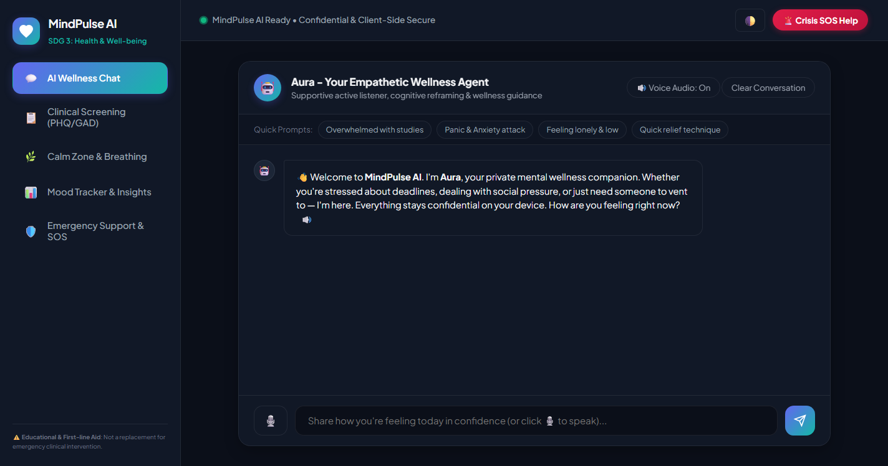
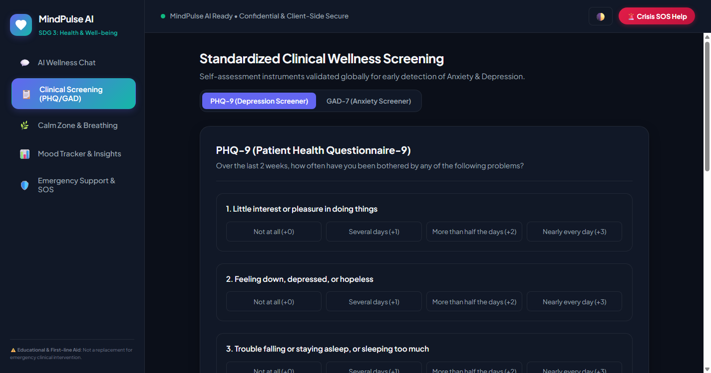
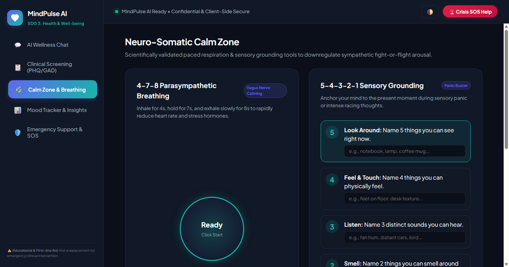

# MindPulse AI 🌿

> **AI-Powered Youth Mental Health Screening & Supportive Wellness Companion**  
> Aligned with **UN Sustainable Development Goal 3: Good Health & Well-being (Target 3.4)**  
> Developed for **IBM SkillsBuild Masterclass 5: Creating Real Life Projects**

---

## 📸 Project Interface Preview

<div align="center">
  
  <p><em>Aura: Private Empathetic Wellness Chat with Speech Dictation & Audio Read-Out</em></p>
</div>

<br/>

<div align="center">
  
  <p><em>Standardized Clinical Triage: Validated PHQ-9 (Depression) & GAD-7 (Anxiety) Screeners</em></p>
</div>

<br/>

<div align="center">
  
  <p><em>Calm Zone: Parasympathetic 4-7-8 Breathing, 5-4-3-2-1 Sensory Grounding & Synthesized Soundscapes</em></p>
</div>

---

## 🌟 Overview

**MindPulse AI** is a confidential, zero-stigma mental wellness web platform engineered to bridge the critical gap between silent youth distress and professional healthcare. 

It equips young individuals with an empathetic conversational companion (**Aura**), globally validated clinical psychometric screening instruments (**PHQ-9** and **GAD-7**), real-time neuro-somatic calming tools, and instant 24/7 crisis safety routing — with **100% on-device client privacy**.

---

## ✨ Core Features

| Module | What It Does | Clinical / User Benefit |
| :--- | :--- | :--- |
| **💬 Aura AI Wellness Companion** | Empathetic active listener trained in Cognitive Behavioral Therapy (CBT) reframing. Supports voice dictation (🎙️) and speech read-out (🔊). | Deconstructs exam panic, imposter syndrome, and loneliness in real-time. |
| **📋 Standardized Clinical Screeners** | Full self-administered **PHQ-9** (Depression) and **GAD-7** (Anxiety) assessments with instant severity scoring (0–27 / 0–21). | Objective, clinically benchmarked risk stratification without medical intimidation. |
| **🌿 Neuro-Somatic Calm Zone** | Interactive visual pacing circles for **4-7-8** and **Box Breathing** with synthesized Web Audio tone cues. | Mechanically stimulates the parasympathetic vagus nerve, lowering acute heart rate within 90s. |
| **🌧️ Therapeutic Ambient Soundscapes** | Real-time acoustic noise synthesizer with volume controls: **Gentle Rain**, **Ocean Waves**, and **432Hz Alpha Solfeggio Waves**. | Somatic sound therapy masking ambient stressors (zero external MP3 assets needed). |
| **📊 Mood Tracker & Insights** | Daily check-in slider (1–10), contextual trigger tags (*Exam Pressure*, *Social Fatigue*, etc.), 14-day resilience heatmap, and single-click record deletion. | Longitudinal self-reflection, identifying emotional triggers over time. |
| **🛡️ 24/7 Crisis SOS Directory** | Real-time intent detection routing at-risk individuals to verified emergency hotlines: **Tele-MANAS (14416)** and **KIRAN (1800-599-0019)**. | Zero-delay life-saving intervention adhering to psychological duty-of-care guidelines. |

---

## 🔬 Clinical Screening Framework

* **PHQ-9 (Patient Health Questionnaire-9):** 9 validated diagnostic criteria evaluating depressive severity. Includes an automated safety check on Question 9 (self-harm indicator).
* **GAD-7 (Generalized Anxiety Disorder-7):** 7 validated items quantifying generalized anxiety from Minimal to Severe.
* **Clinical Report Generator:** Generates a printable **Clinical Triage Evaluation Summary** with an anonymous patient ID and evidence-based self-care guidance.

---

## 📁 Repository Structure

```text
├── assets/                        # Project UI Screenshots & Visual Assets
│   ├── preview_chat.png           # Aura Chat Interface Screenshot
│   ├── preview_screener.png       # Clinical Screening Interface Screenshot
│   └── preview_calm.png           # Calm Zone & Soundscapes Screenshot
├── index.html                     # Main Web Application UI
├── styles.css                     # Design System (Glassmorphism & Responsive Layout)
├── app.js                         # Core Logic, Audio Synthesizer & Screening Engine
├── LEAN_CANVAS.md                 # Detailed Lean Canvas Markdown Documentation
├── CONCEPT_NOTE.md                # Comprehensive Concept Note Markdown
├── PRESENTATION.md                # Slide-by-slide Presentation Script
└── README.md                      # Project Documentation
```

---

## 🚀 Quickstart & Running Locally

This project runs **100% client-side with zero installations or external dependencies**.

### Option A: Double Click
Open `index.html` directly in any modern browser (Chrome, Edge, Firefox, Safari).

### Option B: Local Server
```bash
# Using Python
python -m http.server 8000

# Open in browser: http://localhost:8000
```

---

## 🔒 Privacy & Ethical Safeguards

1. **Zero Tracking:** No personal diary notes or assessment answers are ever transmitted to external cloud servers.
2. **Local Storage Vault:** All journal reflections and scores remain strictly inside the user's browser sandbox.
3. **Medical Disclaimer:** MindPulse AI serves as an educational self-management aid and first-line triage companion, not as a replacement for certified clinical intervention.

---

## 📜 Submission Details

* **Program:** IBM SkillsBuild Masterclass 5: Creating Real Life Projects
* **Thematic Track:** UN SDG 3 (Target 3.4 — Mental Health & Well-being)
* **Author / Team:** Deep-tech-1314
* **License:** MIT License
